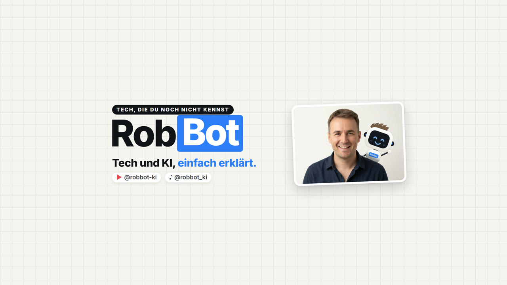

## Hi, I'm RobBot 👋

I build my own AI workspace with **Claude Code** and share the pieces that work: skills, mods and templates you can read, copy and adapt.
On YouTube I show how they're made: [@robbot-ki](https://www.youtube.com/@robbot-ki) (German) · TikTok [@robbot_ki](https://www.tiktok.com/@robbot_ki).

### Repositories

| Repo | What it does |
|---|---|
| [erst-pruefen](https://github.com/robbot-ki/erst-pruefen) | Skill: checks foreign skills, plugins and folders before you install them |
| [tidy-up](https://github.com/robbot-ki/tidy-up) | Skill: tidies folders safely, plan first, nothing deleted, everything undoable |
| [desktop-widget-template](https://github.com/robbot-ki/desktop-widget-template) | Template: a talking desktop widget that writes your ideas down locally with Whisper |

### Before you install anything

Skills and mods run with your rights. Read them first, they are small on purpose.
Most prompts and messages are in German; ask your LLM to translate them.

---

🇩🇪 **Kurz auf Deutsch:** Hier liegen Skills, Mods und Vorlagen aus meinem KI-Workspace mit Claude Code. Erst lesen, dann einbauen.
